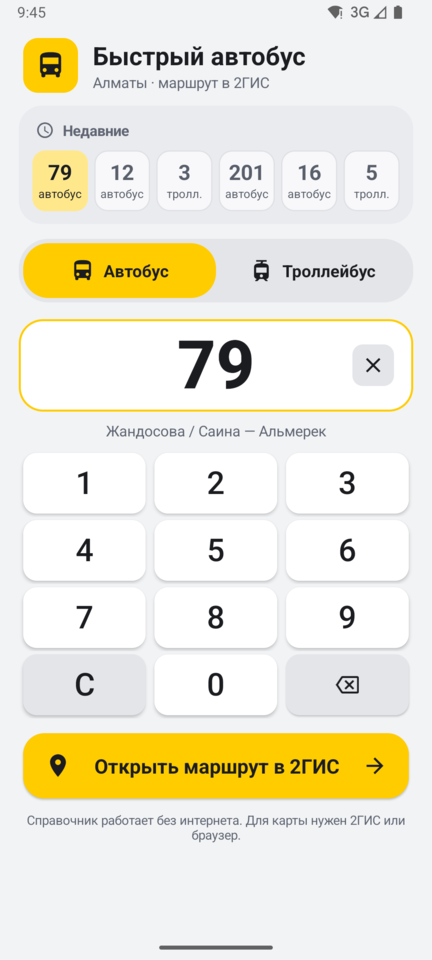

# Быстрый автобус

Мини-приложение для Алматы: крупная цифровая клавиатура → номер автобуса → карточка маршрута в 2ГИС.

**Открыть в браузере (iPhone, Android, компьютер):** https://megannnn98.github.io/almaty-bus-quick/
Android-приложение (APK): [релизы](https://github.com/megannnn98/almaty-bus-quick/releases).



## Веб-версия: установить на экран «Домой»

Веб-версия ничего не скачивает из магазинов, не требует аккаунта и после первого открытия работает без интернета (для самой карты нужен 2ГИС или сеть).

**iPhone (Safari):**
1. Откройте https://megannnn98.github.io/almaty-bus-quick/ в Safari.
2. Нажмите «Поделиться» (квадрат со стрелкой вверх).
3. Выберите «На экран „Домой“» → «Добавить».

**Android (Chrome):**
1. Откройте https://megannnn98.github.io/almaty-bus-quick/ в Chrome.
2. Меню ⋮ → «Добавить на главный экран» (или «Установить приложение») → «Установить».

Иконка «Автобус» откроет приложение на весь экран. Маршрут открывается в приложении 2ГИС, если оно установлено, иначе — на сайте 2ГИС.

## Что умеет

- Ввод номера 1–999 одной рукой; номер не начинается с нуля. «C» очищает, ⌫ стирает цифру (долгое нажатие очищает всё).
- Переключение между автобусом и троллейбусом, чтобы не путать одинаковые номера.
- После успешного открытия маршрута ввод очищается автоматически.
- Последние 6 уникальных маршрутов (автобусы + троллейбусы) сохраняются между запусками (Android — SharedPreferences, веб — localStorage браузера); касание недавнего маршрута сразу открывает его.
- Из локального `routes.tsv` сразу открывает **конкретный** маршрут в 2ГИС.
- Если точного URL нет, открывает **поиск** маршрута в 2ГИС. Это не то же самое, что открыть схему.
- Не требует геолокации, фоновых сервисов, API-ключа или сетевых разрешений самого приложения.

Предзаполненные автобусные маршруты: **2, 3, 10, 12, 77, 79**. Остальные доступны через поисковую ссылку, пока справочник не обновлён.

## Как собрать

Используйте Android Studio с Android SDK 35, JDK 17, Gradle 8.9 и Android Gradle Plugin 8.7.3. Откройте корневую папку проекта.

Если Gradle Wrapper ещё не создан, установите Gradle и выполните в корне:

```bash
gradle wrapper --gradle-version 8.9
./gradlew testDebugUnitTest assembleDebug
```

APK после сборки: `app/build/outputs/apk/debug/app-debug.apk`.

**Без локальной Android SDK:** отправьте проект в свой GitHub-репозиторий, запустите workflow `Android APK` в Actions, скачайте артефакт `bus-route-quick-debug-apk`.

## Обновить справочник

На ПК с доступом к интернету и Python 3.10+:

```bash
python tools/update_routes.py
```

Скрипт читает каталог [Алматыэлектротранса](https://aet.kz/ru/routes/), по одному запрашивает страницы маршрутов и извлекает официальные ссылки 2ГИС. Неизвестные маршруты других перевозчиков из этого источника не появятся. Перед запуском добавления многих маршрутов можно опробовать `--limit 5`.

Встроенные ссылки также можно дополнять вручную в `app/src/main/assets/routes.tsv` (формат: `kind`, `number`, `url`, `description`, табуляция). Этот же файл использует веб-версия: при публикации он копируется на сайт.

## Ограничения

- APK собирается в GitHub Actions; интерфейс и переход в 2ГИС ещё требуют проверки на устройстве.
- Deep link `dgis://2gis.ru/almaty/route/...` заявлен в документации 2ГИС для открытия приложением, но именно путь карточки маршрута ещё требует проверки на реальном Android. При отсутствии обработчика используется HTTPS-ссылка.
- Прямые маршруты в каталоге относятся только к перевозчику «Алматыэлектротранс»; не все маршруты Алматы охвачены.
- ONAY! и распознавание номера камерой в этой версии не реализованы.

## Технически

- Kotlin + стандартные Android Views, без Compose и сторонних UI-зависимостей.
- Строгая проверка ссылок `https://2gis.kz/almaty/route/<id>` и телефонный `ACTION_VIEW`.
- Чистая логика `RouteCatalog` вынесена из `Activity`, имеются unit-тесты.
- Веб-версия в `web/`: HTML, CSS и JavaScript без фреймворков и сборки; логика в `web/core.js` повторяет Kotlin-код, офлайн-режим через service worker. Публикуется на GitHub Pages workflow `Web app (GitHub Pages)` после unit-тестов.

## Локальные проверки без Android SDK

```bash
bash tools/smoke_test.sh
```

Скрипт проверяет Python-парсер и чистую Kotlin-логику `RouteCatalog`; Android UI проверяется уже на телефоне или эмуляторе.

Веб-версия (Node.js 22+ и Python 3):

```bash
node --test tests/web/*.test.js   # unit-тесты логики
tools/serve_web.sh                # просмотр на http://127.0.0.1:8000
```
